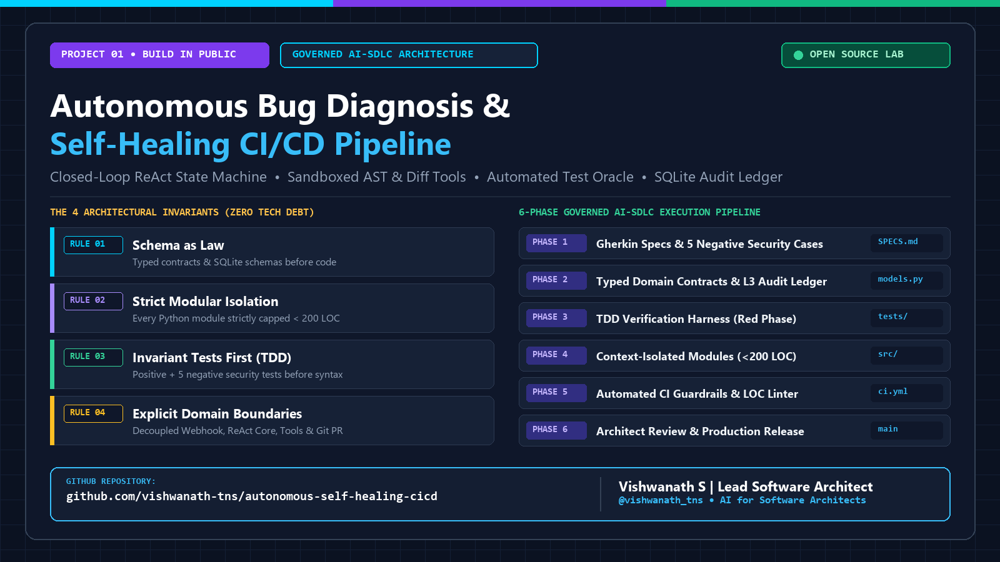

# Project 01: Autonomous Bug Diagnosis & Self-Healing CI/CD Pipeline
### Governed AI-SDLC & Disciplined Vibe Coding Execution Plan

**Author:** Vishwanath S | Lead Software Architect ([@vishwanath_tns](https://x.com/vishwanath_tns))  
**Architecture Pattern:** Closed-Loop ReAct State Machine + Deterministic Tool Registry + Automated Test Oracle  
**Printable Executive Plan:** [📄 Download SDLC_PROJECT_PLAN.pdf](./SDLC_PROJECT_PLAN.pdf)



---

## 1. Executive Objective

Build a production-grade **Autonomous Bug Diagnosis & Self-Healing CI/CD Agent** following a strict, governed Software Development Life Cycle (SDLC). Rather than unguided "vibe coding" that produces monolithic spaghetti and untested happy paths, this project enforces **Architectural Governance** at every stage:

* **Zero-Dependency Simulation Mode + Live Gemini Mode:** Runs out-of-the-box with Python 3.11+ standard library and upgrades seamlessly to live Google Gemini tool-calling when `GEMINI_API_KEY` is provided.
* **Sub-3-Minute MTTR:** Automatically ingests failing CI stack traces, localizes the root cause in source code, synthesizes a minimal defensive patch, verifies the fix in a sandboxed test runner, records an immutable SQLite audit trail, and prepares a clean Git branch & Pull Request.

---

## 2. The 4 Invariant Rules of Disciplined Vibe Coding

Every file and commit in this repository obeys four non-negotiable architectural invariants:

| Rule | Invariant Principle | Architectural Enforcement in This Repo |
| :--- | :--- | :--- |
| **Rule 1** | **Schema as Law (Contracts Before Code)** | Define strict typed schemas (`StackFrame`, `ToolCall`, `PatchProposal`, `HealCycleReport`, `AuditRecord`, `CIWebhookEvent`) before writing business logic. Prevents context amnesia across prompts. |
| **Rule 2** | **Strict Modular Isolation (`< 200 LOC` / file)** | Every source file in `src/` has a single responsibility and is strictly capped at `< 200 lines of code` (verified automatically in CI). |
| **Rule 3** | **Invariant Tests Before Syntax (TDD for Agents)** | Write unit tests and explicit negative failure-mode assertions *before* implementing module code. The implementation iterates against deterministic tests. |
| **Rule 4** | **Explicit Public Domain Boundaries** | Strict decoupling between Webhook Ingestion, ReAct Reasoning Core, Sandboxed Tool Registry, L3 SQLite Audit Ledger, and Git/PR Publisher. |

---

## 3. End-to-End Runtime Flow

```text
[1. CI Webhook Fires] ──► Build #104 failed! Raw traceback sent to Agent.
         │
         ▼
[2. Trace Parser]     ──► Strips noise. Extracts: file="order_service.py", line=21, error="KeyError: 'discount_tier'"
         │
         ▼
[3. ReAct Loop: Read] ──► Agent calls Tool: read_source_file("order_service.py", lines 15..27)
         │
         ▼
[4. ReAct Loop: Think]──► Agent sees `tier = order["discount_tier"]`. Synthesizes defensive fix: `order.get("discount_tier", "NONE")`
         │
         ▼
[5. Guardrail Check]  ──► Is "order_service.py" allowed to be modified? YES (not a Dockerfile or CI workflow).
         │
         ▼
[6. Atomic Patch]     ──► Saves a backup snapshot in memory, then replaces the exact line in "order_service.py".
         │
         ▼
[7. Sandbox Test Run] ──► Runs `python -m unittest` in an isolated subprocess with a 30-second timeout.
         │
         ├──► IF TESTS FAIL (Exit != 0): Roll back the bad patch, feed the new error back to Step 4 (Max 3 retries).
         │
         └──► IF TESTS PASS (Exit == 0):
                   ├──► Record full audit trail in SQLite (`audit_ledger.db`)
                   └──► Create branch `fix/auto-build-104` & emit Pull Request with test proof!
```

---

## 4. Target Repository Architecture

```text
autonomous-self-healing-cicd/
├── README.md                        # Project Overview & Governed AI-SDLC Execution Plan
├── ARCHITECTURE.md                  # System Specification, FSM Lifecycle & Tool Contracts
├── SDLC_PROJECT_PLAN.md             # Governed AI-SDLC Execution Plan (Markdown)
├── SDLC_PROJECT_PLAN.pdf            # Executive Printable Project Plan (PDF)
├── SPECS.md                         # Phase 1: Gherkin Acceptance Criteria & 5 Negative Cases
├── src/
│   ├── __init__.py
│   ├── models.py                    # Rule 1: Typed Data Contracts & Enums (< 200 LOC)
│   ├── guardrails.py                # Blast-Radius Policy & Path Traversal Protection (< 200 LOC)
│   ├── trace_parser.py              # Stack Trace Regex & AST Localization (< 200 LOC)
│   ├── tools.py                     # Sandboxed Tool Registry: Read, Patch, Test Runner (< 200 LOC)
│   ├── audit_ledger.py              # L3 SQLite Audit Ledger for Compliance & Traceability (< 200 LOC)
│   ├── llm_client.py                # Dual-Mode Reasoning Engine: Sim + Live Gemini w/ L1 Cache (< 200 LOC)
│   ├── agent.py                     # Stochastic FSM & ReAct Controller w/ Circuit Breaker (< 200 LOC)
│   ├── git_publisher.py             # Automated Branch & Pull Request Emitter (< 200 LOC)
│   └── webhook_app.py               # HTTP / FastAPI CI Failure Webhook Gateway (< 200 LOC)
├── target_service/                  # Microservice Under Test
│   ├── __init__.py
│   ├── order_service.py             # Financial Order Processing Service
│   └── test_order_service.py        # Unit Test Suite
├── tests/                           # Rule 3: TDD Verification Harness
│   ├── test_contracts_and_ledger.py # Schema & SQLite L3 Ledger Tests
│   ├── test_tools_and_guardrails.py # Tool Execution & Negative Security Invariants
│   ├── test_agent_fsm.py            # End-to-End ReAct FSM & Circuit Breaker Tests
│   └── test_webhook_and_git.py      # Webhook Ingestion & PR Publisher Tests
├── diagrams/                        # Architecture Diagram Generators & Assets
│   ├── generate_diagram.py
│   ├── generate_diagram_mobile_white.py
│   └── Project_01_Architecture_Diagram.png
├── run_demo.py                      # 1-Click End-to-End Autonomous Repair Demo
└── .github/workflows/ci.yml         # Automated CI Pipeline + <200 LOC Architecture Gate
```

---

## 5. Step-by-Step 6-Phase SDLC Execution Roadmap

We execute one phase at a time with an explicit **Human Architect Approval Gate** between phases:

| Phase | Milestone | Deliverable | Status |
| :--- | :--- | :--- | :--- |
| **Phase 0** | **SDLC Plan & Repository Setup** | `README.md`, `SDLC_PROJECT_PLAN.pdf` | ✅ Completed |
| **Phase 1** | **Requirements & Spec Engineering** | `SPECS.md` (Gherkin + 5 Negative Security Cases) | 🔜 Next |
| **Phase 2** | **Architecture & Contract Definition** | `src/models.py`, `src/audit_ledger.py`, `ARCHITECTURE.md` | ⏳ Planned |
| **Phase 3** | **Test-Driven Harness First (TDD Red Phase)** | `tests/test_*.py` (Unit + 5 Negative Invariants) | ⏳ Planned |
| **Phase 4** | **Context-Isolated Module Implementation** | `src/*.py` (`< 200 LOC` per file, Dual-Mode Engine) | ⏳ Planned |
| **Phase 5** | **Automated CI/CD Guardrails** | `.github/workflows/ci.yml` (Tests + `< 200 LOC` Gate) | ⏳ Planned |
| **Phase 6** | **Senior Architect Review & Release** | Final Verification, Docs & Production Tag | ⏳ Planned |

---

### Detailed Phase Breakdown

#### Phase 1: Requirements & Spec Engineering (`SPECS.md`)
* Define formal state transitions: `INGESTION` $\rightarrow$ `LOCALIZATION` $\rightarrow$ `HYPOTHESIS` $\rightarrow$ `PATCHING` $\rightarrow$ `VERIFICATION` $\rightarrow$ `PR_EMISSION` / `CIRCUIT_BREAKER_ABORT`.
* Write strict **Gherkin (`Given-When-Then`)** acceptance criteria for every state transition.
* Specify **5 Mandatory Negative & Security Test Cases**:
  1. **Blast-Radius Violation:** Agent attempts to modify forbidden infrastructure files (`Dockerfile`, `.github/workflows/ci.yml`, `pyproject.toml`) $\rightarrow$ Blocked immediately by `GuardrailViolationError`.
  2. **Max-Retry Circuit Breaker:** Candidate patches fail verification 3 consecutive times $\rightarrow$ Loop aborts cleanly on iteration 3, restores original file state, and logs `CIRCUIT_BREAKER_ABORT`.
  3. **Subprocess Timeout Protection:** A bad patch introduces an infinite `while True` loop $\rightarrow$ Sandboxed test runner enforces a strict timeout and kills the child process safely.
  4. **Non-Exact / Hallucinated Diff Target:** Agent attempts to patch a code snippet that does not match the target file $\rightarrow$ Rejected atomically with zero file corruption.
  5. **Idempotency on Healthy Build:** Agent is triggered when all tests already pass $\rightarrow$ Exits immediately with status `ALREADY_PASSING` and `0` iterations.

#### Phase 2: Architecture & Contract Definition (`src/models.py` & `src/audit_ledger.py`)
* Define immutable data structures for `StackFrame`, `TestRunResult`, `PatchProposal`, `TrajectoryStep`, `HealCycleReport`, and `CIWebhookEvent`.
* Define the SQLite L3 schema (`healing_audit_ledger` table storing `build_id`, `timestamp`, `exception_type`, `target_file`, `line_number`, `applied_diff`, `iterations`, `final_status`, `pr_branch`).

#### Phase 3: Test-Driven Harness First — TDD Red Phase (`tests/`)
* Write `tests/test_contracts_and_ledger.py`, `tests/test_tools_and_guardrails.py`, `tests/test_agent_fsm.py`, and `tests/test_webhook_and_git.py` *before* writing the core engine modules.

#### Phase 4: Context-Isolated Module Implementation — TDD Green Phase (`src/`)
* Implement `src/guardrails.py`, `src/trace_parser.py`, `src/tools.py`, `src/llm_client.py`, `src/agent.py`, `src/git_publisher.py`, and `src/webhook_app.py` one module at a time, keeping every file `< 200 LOC`.

#### Phase 5: Automated CI/CD Guardrails (`.github/workflows/ci.yml`)
* Configure GitHub Actions to enforce the `< 200 LOC` modular isolation gate, run all positive and negative unit tests, and execute `python run_demo.py` on every push.

#### Phase 6: Senior Architect Review, Documentation Polish & Release
* Audit all system boundaries, verify 100% test pass rate, and publish the final release.
